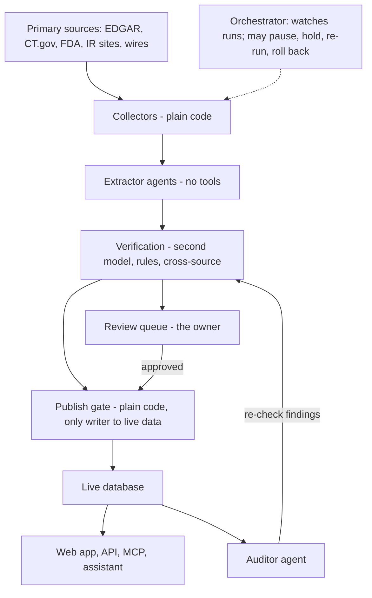

# Biotech Catalyst Platform Spec

> Source of truth for implementation. Readable copy with diagrams: the "Biotech Catalyst Platform Spec" doc in Claude (ask the owner for the link). Change this file by pull request; record the reason as an ADR.

## Overview

The platform tracks catalysts for US-listed biotech and biopharma companies, foreign ones included, and later for companies listed only abroad (ADR 0021) and for the regulated medical device and medical robotics industries (ADR 0027), and links every record to its primary source. It adds analysis no retail tool offers: readout benchmarking, market sizing, and price-impact statistics. Launch targets retail investors and small institutions with one paid tier at $15 a month.

The product rests on five openings found in the [competitor matrix](https://claude.ai/artifact/SX48JvRPdXX7iQFBwTt3WG):

1. **Primary-source link on every record.** Only Dropwatch does this today, and it has no PDUFA dates.
2. **Date confidence and date-change history.** No competitor documents how a catalyst date moved over time.
3. **Readout benchmarking** against competitor programs, approved drugs, and the standard of care.
4. **Market-size estimates** at a retail price.
5. **Price-impact statistics** with published accuracy, not unbacked predictions.

| Decision | Choice |
| --- | --- |
| First customers | Retail investors and small institutions |
| Pricing at launch | Free tier plus one $15/month tier; API tier (\~$50/month) on the roadmap |
| Ingestion cadence | Twice daily: pre-market and post-close |
| Advice | Never personalized investment advice |
| Verification | Independent cross-checks; any model provider can be plugged in |
| Human role | You settle the records the weekly sample checker disagrees on, and the flagged queue (owner decision 2026-10-17) |
| Deferred | Business setup (entity, terms, billing) and the distribution plan |

**Not in v1:** seconds-level latency, institutional features (SSO, security audits, bulk feeds), and a native mobile app.

## Offering

The free tier gives away trust: an accurate, sourced 30-day calendar that anyone can check. The paid tier sells time horizon, history, speed, personalization, and analysis. Source links are never paywalled, because they are the proof of accuracy that makes people pay.

| Feature | Free | Paid ($15/month) |
| --- | --- | --- |
| Catalyst calendar | Next 30 days | Full horizon |
| Primary-source link and quote | Every record | Every record |
| Date confidence label | Yes | Yes |
| Date-change history | Latest change only | Full history, with slip alerts |
| Historical outcomes | Last 90 days | Full archive |
| Public pages (catalyst, drug, company, indication) | Summary | Full detail |
| Search and filters | Ticker, date, phase, catalyst type | All filters, saved searches |
| Watchlists and board | 1 list and 1 board, 10 items | Unlimited, with the timeline board |
| Alerts | Weekly email digest | Email, text message (monthly cap), web push, Slack, Discord, Teams, Telegram, webhooks; sent each run |
| Interest feeds | No | Yes, with RSS |
| Readout benchmarks | One featured benchmark per week | All |
| Market-size estimates | No | Yes |
| Catalyst scenarios | One featured catalyst per week; accuracy record always | All |
| Price-impact statistics | Base rates by catalyst type | Per event, per company, filterable |
| Cash runway and dilution flags | No | Yes |
| Research assistant | 3 questions a day | 50 a day (fair-use cap) |
| Research reports (Phase 11) | Summary page with one headline figure and every source | Full reports (or sold one at a time; owner decides; ADR 0032) |
| Export | Calendar (.ics) | Calendar and CSV |
| MCP access for AI agents | Calendar tools, rate-limited | All tools, higher limits |

$15 a month is below every competitor's paid tier, which runs $20 to $99. The low price has a cost: $200,000 a year needs about 1,110 subscribers before card fees, and $500,000 needs about 2,780. The price can rise once benchmarks ship.

## Data sources and coverage

All launch sources are free public feeds, and plain code (not AI agents) collects them twice each weekday. Coverage starts with US-listed therapeutics developers filed under SEC industry codes 2834 (pharmaceutical preparations), 2836 (biological products), and 8731 (commercial biological research); building that list needs no price data. It grows toward the 1,500 to 1,800 companies competitors track. Foreign companies follow in two stages (owner request 2026-10-17; ADR 0021). First come those listed in the US: they are already on the coverage list, and most file Forms 6-K and 20-F (or 40-F) on EDGAR instead of 8-K and 10-K, so the collector reads the forms each company actually files. Then come companies listed only outside the US, market by market, each source checked first for its terms, any key, and its language.

| Source | What it supplies | Access |
| --- | --- | --- |
| [SEC EDGAR](https://www.sec.gov/os/accessing-edgar-data) | 8-K press-release exhibits, 10-Q/10-K cash and burn, S-3 and 424B offerings; for foreign issuers, 6-K press releases and results, 20-F and 40-F annual reports, and F-1, F-3, and F-10 offerings (ADR 0021) | Free API; 10 requests/second limit; declared User-Agent |
| [ClinicalTrials.gov API v2](https://clinicaltrials.gov/data-api/api) | Trial design, endpoints, enrollment, primary completion dates, posted results | Free API |
| Company investor-relations sites | Press releases, event dates, presentations | RSS or page fetch, only for companies whose releases miss the wires and 8-Ks; store facts and links, not full text |
| Wire services (GlobeNewswire, Business Wire, PR Newswire) | Same releases, often minutes earlier | Public RSS feeds |
| [openFDA](https://open.fda.gov) and Drugs@FDA | Approvals, labels, designations | Free API |
| [Federal Register](https://www.federalregister.gov/developers/documentation/api/v1) | Advisory committee meeting notices | Free API |
| [PubMed](https://pubmed.ncbi.nlm.nih.gov) | Published trial results for benchmarking | Free API |
| Conference abstract sites (ASCO, ASH, ESMO, AACR) | Readout timing and data | Public pages; respect embargoes |
| Stock prices | Daily prices for price-impact statistics | No free source is licensed for display (see Open questions) |

**Cadence.** Run 1 at 08:30 ET catches pre-market releases before the 09:30 open. Run 2 at 17:30 ET catches post-close releases. A light Saturday run catches weekend filings. Schedules run on New York time, so they follow daylight saving. Every source document's publication time is logged, so the run times can be tuned from real data after month one. Target: verified facts publish within 2 hours of each run.

**Catalyst types.** PDUFA dates, advisory committees, topline readouts (phase 2 and later, including Phase 4 post-marketing studies whether run by the company or independently, plus notable phase 1; ADR 0028), conference presentations, regulatory submissions and acceptances, EMA CHMP opinions, complete response letters, label expansions, enrollment completion, offerings and shelf filings, and M&A. From Phase 10, corporate events from filings (executive arrivals and departures, major financings, collaborations and deals) upcoming deal dates (closing window, shareholder vote, tender expiration, antitrust waiting-period end), and commercial milestones (a growth blocker the company names, such as limited manufacturing capacity or missing reimbursement, with its fix and timeline, labeled "company expectation"), and safety events (clinical holds, halted trials, reported deaths and side effects, safety label changes, recalls) appear in their own "Corporate events" section. A competitor whose shares moved beyond a set threshold the same day gets a "peer event" entry, labeled as a same-day move whose cause is not established (ADR 0030). Earnings dates are shown as context only.

## Data model

Every displayed value is computed from **claims**, and every claim points to one source document and the exact words it came from. This makes source linking part of the structure: a value with no claim behind it cannot exist.

| Entity | Canonical ID | Cross-references stored |
| --- | --- | --- |
| Company | Internal UUID | SEC CIK; tickers with valid-from/to dates; former names |
| Drug (asset) | Internal UUID | Code names, generic (INN) and brand names; FDA UNII; ChEMBL ID |
| Target and mechanism | HGNC gene symbol | ChEMBL target ID |
| Indication | MeSH ID | EFO ID; ICD-10 code; line of therapy; biomarker subgroup |
| Modality | Controlled list | Small molecule, antibody, ADC, bispecific, cell therapy, gene therapy, RNAi, antisense, mRNA, vaccine, radiopharmaceutical, peptide, other |
| Trial | NCT ID | EU CT number; company study name |
| Catalyst | Internal UUID | Links to company, drug, indication, trials |
| Source document | Internal UUID | URL, publisher, published-at and retrieved-at times, SHA-256 hash of the stored copy |
| Claim | Internal UUID | One fact, its verbatim quote, its location in the document, the agent, prompt and model versions that extracted it |
| Outcome | Internal UUID | Result category, key numbers, resolution source, price reaction |

**Date precision.** Each catalyst date is stored as a window, not a single day: start, end, precision (day, month, quarter, half, year), the raw text as written ("2H26"), and a confidence label. The labels are: company-confirmed, regulator-scheduled, registry estimate, and inferred. Alerts fire when a window opens, narrows, or moves.

**Change history.** The catalyst table is append-only. Each change records the old value, new value, the claim that caused it, and when we learned it. A readout that slips from 1H to 2H shows as a dated entry users can see and get alerted on. A slip often signals trouble, so this history becomes its own dataset.

**Which claim wins.** When claims disagree, the live value comes from the highest-ranked source in the Provenance ranking; among sources of equal rank, the most recently published wins. Losing claims stay attached to the record and are shown as conflicts. Records waiting in the review queue are never shown publicly.

**Outcomes.** After a catalyst date passes, the outcome agent records the result: approved, complete response letter, advisory vote count, primary endpoint met, missed or mixed, delayed, or withdrawn. Key numbers (response rate, hazard ratio, p-value) and the price reaction are stored with their sources. Over time this builds a base-rate archive that new entrants cannot copy quickly.

## Provenance

No record publishes without a deep link to the primary document that states it, plus the sentence that states it. Competitors fall short here: in the research sample, 9 of 10 BioPharmCatalyst links went to its own copy of the news, CatalystAlert named sources without linking them, and one Benzinga link pointed to a different drug's story.

1. **Source ranking.** Use the highest available tier:
   1. Regulator documents (FDA letters, Federal Register notices, EMA opinions) and SEC filings
   2. Company press release on the company's own site
   3. Wire-service copy of the company release
   4. Registry records (ClinicalTrials.gov)
   5. Conference abstracts and journal articles
2. **News is a lead, never a source.** A news article can trigger a search for the primary document. It cannot support a published value on its own.
3. **Deep links only.** Link the exact document, never a homepage. For SEC filings, link the specific exhibit (for example Exhibit 99.1). Where browsers support it, add a text-fragment link that scrolls to and highlights the quoted sentence.
4. **Quote stored with every claim.** The quote is checked by exact string match against the stored copy before publishing.
5. **Snapshot at retrieval.** Store a private copy and its SHA-256 hash, so we can prove what the page said on the day we read it. Copies are for verification, not redistribution.
6. **Link checks.** A weekly job checks every source URL. A dead link triggers a search for the moved document; if none is found, the record shows the retrieval date and an Internet Archive copy where one exists.
7. **Conflicts shown, not hidden.** When sources disagree, the record shows both, which one we use, and the rule that picked it.
8. **Same rules everywhere.** The web page, API, MCP tools, and assistant all return a `sources` list with every value.

**Targets:** 100% of published records carry a primary-source deep link; 0 homepage links; dead-link rate below 1%, measured weekly.

## Agent architecture

Agents that read raw web text get no tools and no database access, and only a plain-code publish gate writes to live data. This blocks the main risk of an agent-run data business: a web page that carries hidden instructions and rewrites records.



Collection and publishing are plain code; AI agents handle reading, judging, and drafting.

| Agent | Job | Can access | Cannot |
| --- | --- | --- | --- |
| Orchestrator | GitHub Actions runs the schedule; this agent reads run results, retries or escalates failures, and alerts you only when something needs you (a failed job, a spending cap reached, a decision that is yours), plus a plain-English weekly summary with the error rate (owner decision 2026-10-17). It watches every product agent and may stop, hold, and re-run: pause a role, hold a run's records from publishing, re-run a job once a day, or go back to the last prompt version that passed its tests. Plain-code rules in `config/orchestrator.toml` decide when; each action is recorded and reported to you with how to undo it (owner decision 2026-10-17; ADR 0019) | Job queue, run logs, check results, spend | Read web text; change records (it writes only its own pause, hold, and action rows); write prompts; change thresholds or caps; lift a pause or hold you set |
| Extractor | Turns one source document into structured claims with quotes | The document it is given | Browse, call tools, write to live data |
| Entity resolver | Maps names to canonical company, drug, and trial IDs | Reference tables | Write to live data; ambiguous matches go to review |
| Verifier | Re-extracts with a different prompt (later a different provider) and runs cross-checks | Staged claims, source copies | Publish |
| Auditor | Re-checks published records: sources still say the same, links alive, dates passed without an outcome | Live data (read), source fetches via collectors | Publish; findings re-enter verification |
| Outcome | Finds and records the result after a catalyst date passes | Same as extractor | Publish |
| Analyst | Drafts benchmarks, market-size estimates, and catalyst-scenario inputs | Published data, published literature | Publish; all drafts go to review in v1 |
| Marketing and outreach | Drafts the weekly newsletter, notes to named people (journalists, newsletter writers, podcast hosts, investor communities), directory submissions, and public-page text, all from published data; no social posts for now (owner decision 2026-10-17; ADR 0020), apart from the Phase 9 X feed, which plain code fills from a template (ADR 0029) | Published data; contact pages fetched by collectors | Send, post, or submit anything; a plain-code sender acts only on text you approved word for word |
| Developer | Claude Code sessions you start, building features as pull requests; there is no always-on coding agent in v1 | Code repository, staging | Merge to main itself or touch production; a merge workflow merges its pull requests after CI and the reviewer agent pass, and you merge changes to that workflow or the review |
| Build overseer | A GitHub Actions job on every pull-request event and once a day: checks that each pull request does one of the next roadmap items (ADR 0033) and follows `AGENTS.md`, finds stuck or drifting work, and keeps a pinned "Build status" issue listing what each building agent is doing (owner decision 2026-10-17; ADR 0019) | Repository, pull requests, CI results (read-only; the model answers in JSON and a plain-code script acts) | Push code, approve, or merge; the script may comment, fail the "Overseer" check, add or remove only its own `overseer-hold` label, re-run a failed CI job once, and open an issue for a decision that is yours |
| Competitor research (after v1) | Weekly report on competitors' changed public pages and new entrants, plus ranked feature ideas for the owner (ADR 0024) | Changed text from dated copies of competitors' public pages, collected by plain code | Browse, call tools, or add roadmap items; ideas wait for the owner |
| CFO (after v1) | Monthly profit and loss, cost per subscriber, churn, runway, and budget versus actual, explained in plain English; drafts cost and price proposals (ADR 0024) | Numbers computed by plain code from Stripe (read-only key), model spend, and owner-entered costs | Pay, refund, change prices or caps, move money, or connect to a bank |
| Suggestions reviewer (after v1) | Daily: scores grouped user feature suggestions against the roadmap and spec and forwards only new, allowed, high-return ideas to you in one issue; nothing on a day with none (owner request 2026-10-18; ADR 0031) | Suggestion text grouped by plain code, the roadmap, the spec | Any tool; change the roadmap; reply to users |
| Research assistant (user-facing) | Helps users find features and data | Published data through the public API | Web browsing; advice; anything a user could not see themselves |

**Prompt-injection defenses:** extractors output only schema-valid JSON; every value must match a verbatim quote found in the stored source; secrets never enter any prompt; each agent has its own least-privilege credentials.

## Verification

A claim publishes automatically only when checks with independent evidence agree. Everything else goes to your review queue. Two runs of the same model on the same press release share the same blind spots, so their agreement counts as weak evidence.

| Check | What it catches | Why it is independent |
| --- | --- | --- |
| Quote match (code) | Invented values: the value must appear inside a quote found verbatim in the stored source | Deterministic string match |
| Second extraction | Misreadings: a second prompt re-extracts the same fields and the results are compared | Different prompt now; a different provider's model once added |
| Rule checks (code) | Impossible values: a PDUFA goal date outside its review window (standard: 10 months, priority: 6 months, counted from FDA's 60-day filing date for new molecular entities and from submission otherwise; plus 3 months when FDA extends a review after a major amendment), a past date marked upcoming, a phase that contradicts ClinicalTrials.gov, an advisory committee with no Federal Register notice | Rules written from regulation, not model output |
| Cross-source match | Single-source errors: the same fact from a second document (press release vs 8-K vs registry) | Different documents |
| Change sanity | Large jumps: a date moving more than 6 months, or an outcome reversing | Always routed to review |

**Publish rule.** Auto-publish when the quote match, second extraction, and rule checks pass, and either a second source agrees or the source is a regulator or SEC filing. Anything else enters the review queue with the reason attached.

### Multi-provider model layer

1. All agent code calls one internal interface, `ModelClient`. It takes a prompt ID and version, the input document, and a JSON Schema, and returns validated JSON plus provider, model, cost, and latency.
2. Each provider (Anthropic first) is an adapter that implements `ModelClient`. Adding a provider means writing one adapter and passing its contract tests; no business code changes.
3. A versioned config file assigns a provider and model to each agent role. Switching the verifier to a second provider is a one-line config change, reviewed like code.
4. Every claim records the provider, model, and prompt version that produced it, so any batch can be re-run, compared, or rolled back.
5. An evaluation harness runs any provider against the gold set and reports accuracy per field. A new provider must match or beat the current one before it is switched on.

### Human review and accuracy measurement

- **Review queue.** One screen shows the highlighted source sentence beside the extracted fields. Approve, correct, or reject in one action, with keyboard shortcuts. Each decision is added to the gold set.
- **Gold set.** Start with 200 hand-verified catalysts. Agents prepare them; you confirm them.
- **Weekly random sample.** Each week 30 auto-published records are drawn at random and checked against their sources by a different, stronger Claude model than the ones that extracted and verified them; you settle only the records where it disagrees (owner decision 2026-10-17). If all 30 are correct, the error rate is below about 10% at 95% confidence; about 300 clean checks push that bound below 1%. This sample is the only real measure of the system's accuracy. Two models from one company can share blind spots, so the planted-error test (records with known, deliberately inserted errors) also runs and shows how many errors the checker catches; a second AI company can replace the checker later.
- **Corrections.** A fixed error gets a change-log entry labeled "correction", alerts everyone watching that catalyst, and appears on a public corrections page.
- **Dashboard metrics:** error rate from the sample, auto-publish rate, queue size, hours from source publication to our publication, and disagreement rate per field.

## Analysis layer

The analysis layer has five products. Four are descriptive. The fifth, catalyst scenarios, estimates conditional price-move ranges (owner decision 2026-10-17); none makes a buy or sell call, and none is tailored to a reader. In v1, agents draft every analysis and you approve it before it publishes. Your immuno-oncology background is the quality gate, so benchmarking starts in oncology.

### Readout benchmarking

Each readout is compared with three reference sets: competitor programs in the same indication and line of therapy, approved drugs (label and pivotal-trial data), and the standard-of-care arm.

- **Data:** ClinicalTrials.gov posted results, PubMed articles, FDA labels via openFDA, conference abstracts.
- **Fields normalized per result:** indication, line of therapy, biomarker population, endpoint and its definition (for example ORR by RECIST 1.1, PFS, OS hazard ratio), comparator, number of patients, median follow-up, phase.
- **Comparability label on every row:** same endpoint and population; similar; or not comparable. Cross-trial comparisons mislead when populations differ, so the label is shown, not buried.
- **Output:** a benchmark table and a forest-style chart per readout, each number linked to its source.

### Market-size estimates

Patients × addressable share × annual price × penetration, shown as low, base, and high scenarios.

- Patient counts from public sources (for example SEER for US cancer incidence, CDC, published epidemiology).
- Addressable share by line of therapy and biomarker.
- Price from comparable approved drugs.
- Every input is sourced and the formula is shown, so users can disagree with a specific input. Labeled "estimate". The estimate itself is never a valuation; only Catalyst scenarios turns it into one.

### Price-impact statistics

An event study around each catalyst, measured against a biotech index (XBI) so market-wide moves are removed.

- Abnormal return on day 0, day +1, and day +5; 30-day pre-event run-up; volume versus its 20-day average.
- **Day 0 alignment:** a release after the 16:00 close counts toward the next trading day. Research on FDA approvals found the share-price effect concentrated in after-close announcements, and misdating the event day distorts results ([UCC study](https://cora.ucc.ie/handle/10468/12099)).
- Base rates grouped by catalyst type, phase, outcome, and market-cap bucket.
- **No predictions in v1** except catalyst scenarios (below). Any predictive feature must publish its accuracy against a naive baseline. CatalystAlert's own track record shows its model scoring below an always-neutral baseline.
- **Data license limit:** the API and MCP serve event-window statistics only, never continuous price or return series. A full return series can rebuild the price history, which data vendors' terms forbid.

### Catalyst scenarios

For an upcoming catalyst, a set of "what if" outcomes, each with a ballpark effect on the company's value and share price (owner decision 2026-10-17). The point is legibility: anyone can see every guess that went in and disagree with a specific one.

- **Scenarios.** Built from the outcome measure the trial actually uses, net of placebo where the trial has one. For example: symptom reduction of 10%, 20%, or 30% on the primary endpoint; side effects better than, equal to, or worse than the leading marketed drug; and failure. Every catalyst carries downside scenarios as well as upside ones (owner decision 2026-10-17): a result below what is needed, a missed primary endpoint, a safety problem, and a delay, each with its own range, which is usually negative (for example "-30% to -80%"). Readout benchmarking supplies the competitors; any comparison its comparability label marks "not comparable" is shown as such, never silently used.
- **What would count as positive or negative** (later, owner request 2026-10-17). For each measure the trial uses, reference ranges drawn from benchmarks, approved drugs' labels, and published trials in the same disease and line of therapy. For example: the response rate below which a result is likely read as negative, the range that matches the standard of care, and the level above which it is likely read as clearly positive. Each boundary links to the results it comes from, and each scenario says where it falls on these ranges.
- **Model per scenario,** each input sourced and its reasoning written out; ADR 0017 sets the defaults and their sources:
  1. Patients reachable: the market-size estimate for the indication, line of therapy, and biomarker group; US and ex-US counted separately.
  2. Share captured: from efficacy and side effects relative to the standard of care, marketed drugs, and competitors in development, and from the order of arrival to market.
  3. Net price: from comparable marketed drugs; where none is comparable, a stated analog with the reason.
  4. Launch year and uptake: years to launch from the phase after the catalyst, then a standard uptake curve to peak.
  5. Years of sales: to expected loss of exclusivity (FDA Orange Book or Purple Book, company 10-K patent disclosures).
  6. Chance of approval from the phase the drug will be in after the catalyst: published base rates by phase and disease area (for example the BIO/Informa clinical development success-rate report).
  7. Economics: operating margin on sales (or a stated sales multiple), remaining development cost, and partner terms (royalty versus owned sales) from the company's filings.
  8. Company: cash and debt from the latest 10-Q; diluted share count from SEC filings; the company's other programs valued the same way. A company that must raise cash before launch (cash-runway flags) has the expected new shares counted in each scenario.
  9. Result: estimated peak sales; risk-adjusted value (probability-weighted and discounted at a stated rate) of the program; and the company's value in that scenario as (program value + other programs + cash - debt), shown as a share of its market value.
- **Price-move range.** For each scenario: (company value in that scenario ÷ current market value) - 1. The "before" is the market's own price, not our model's. The low and high ends come from running the low and high market-size cases. Shown as a range (for example "+5% to +100%"), never a single target, and checked against how share prices moved after similar past catalysts (Price-impact statistics), with any gap between the two shown.
- **Readers.** Every page, alert, API response, and MCP tool description that carries scenarios shows "Estimate. Not financial advice." Nothing is tailored to a reader's holdings. Scenarios publish on a regular schedule (with each catalyst record and its weekly refresh), not as one-off pieces timed to a market event.
- **Accuracy record.** After each catalyst resolves, the actual result is mapped to its scenario (a 15% result falls between the 10% and 20% cases), and the actual move is measured as abnormal return against XBI on day 0 and day +1, as in Price-impact statistics. Ranges are scored with an interval score, which penalizes width, so a very wide range cannot look right just by being wide; the score is published against a naive baseline (the typical range for that catalyst type and phase, at the same coverage). A backtest on past catalysts publishes at launch, and the record is free, on the site and through the API and MCP.
- **Review.** In v1, an AI analyst drafts the inputs with sources and you approve them before they publish.
- **Data.** Share counts come free from SEC filings. Market value needs share prices, so this feature waits for the price-data license (Open questions: Tiingo's written confirmation, or Redistribution).

### Cash runway and dilution

Cash and quarterly burn from 10-Q and 10-K filings give months of runway. New S-3 shelf registrations and 424B prospectus filings trigger dilution flags. Users asked for catalyst, runway, and dilution on one screen; no competitor joins them.

## User features

Search and alerts are built for users who track one area closely: they filter on many dimensions, save the filter, and get alerted when anything in it changes.

### Search and filters

Full-text search across companies, drugs, trials, and catalysts, with these filters (paid users get all; free users get the first four):

| Filter | Values |
| --- | --- |
| Ticker or company | Any covered company, including former names and tickers |
| Date window | Any range; includes catalysts whose window overlaps it |
| Phase | Preclinical through approved |
| Catalyst type | The types listed under Data sources |
| Date confidence | Company-confirmed, regulator-scheduled, registry estimate, inferred |
| Indication | MeSH tree, so "lung cancer" includes NSCLC and SCLC; line of therapy; biomarker |
| Therapeutic area | Oncology, neurology, immunology, and others |
| Modality | The controlled list in the data model |
| Target or mechanism | Gene symbol or mechanism of action |
| Market cap | Size buckets from SEC-reported public float until price data is licensed; market cap after |
| Cash runway | Months of cash; dilution flag present |
| Country | Company headquarters; listing exchange |
| Regulator | FDA, EMA (later PMDA and NMPA) |
| Designations | Breakthrough, Fast Track, Orphan, Priority Review, Accelerated Approval |
| Status | Upcoming, slipped, resolved; outcome category |
| Has analysis | Benchmark available; market-size estimate available |

Any search can be saved, watched, exported, or opened as an MCP query.

### Watchlists and alerts

- **Watch** a catalyst, company, drug, indication, or saved search.
- **Alert triggers:** new matching catalyst; date window opens, narrows, or slips; outcome posted; advisory committee scheduled; new offering or shelf filing; correction to a watched record.
- **Channels:** email, web push, and Slack (incoming webhook); from Phase 9 also text message (capped per user each month), Discord, Microsoft Teams, Telegram, and the user's own webhook (ADR 0029). Alerts go out right after each twice-daily run publishes. Users choose channels per watchlist, instant or a daily digest, and quiet hours.
- **Board (Phase 9):** pinned items on a timeline that draws each date window at its real length, with grouping, an overlap view, and slips shown as moves; a table view carries the same data (ADR 0029).
- **Most watched (Phase 9):** a ranking of the catalysts most watched and most alerted over 7 days, from totals only and only once at least 10 users watch a catalyst; never names a user (ADR 0029).

### Interest feeds

Users pick disease areas, modalities, targets, market-cap ranges, countries, and companies. The feed shows matching new catalysts, changes, and outcomes, newest first, and is also available as RSS.

### Public pages

One server-rendered page per catalyst, drug, company, and indication, with structured data (schema.org) for search engines. Free visitors see the summary and every source link; paid users see full history and analysis.

### Research assistant

- Helps users find features and data: "which PDUFA dates in oncology slipped this quarter?"
- Answers only from published data through the public API, citing our records and their sources.
- Shows the filter it used, with a button to open it as a saved search, so users learn the interface.
- Refuses personal advice ("should I buy", "is my portfolio exposed") with a fixed message. It may quote published catalyst scenarios, never apply them to a user's holdings.

### Other

- Calendar export (.ics) for any watchlist or search; CSV export on the paid tier.
- Responsive web app installable on phones (progressive web app); no native app in v1.
- Accessibility target: WCAG 2.2 AA.

## Machine access

One API sits under everything: the web app, the MCP server, and the research assistant all call it. Anything a person can see, an AI agent can query the same way. MCP ships in v1 for all users; the public REST API tier (about $50/month) offers every published dataset in Phase 10 (ADR 0030).

**REST API**

- OpenAPI 3.1 specification, generated from the same data models as the database.
- Versioned paths (`/v1/...`), JSON, cursor pagination, ETags for caching, rate limits by tier.
- Every object includes `sources` (URL, publisher, quote, retrieved-at) and a link to its change history.
- Stable canonical IDs plus lookups by ticker, CIK, NCT ID, and drug name.

**MCP server**

- Remote server over streamable HTTP; OAuth for paid users, rate-limited anonymous access for free calendar tools.
- Planned tools:

| Tool | Returns | Tier |
| --- | --- | --- |
| `list_upcoming_catalysts` | Catalysts in a date window, with filters | Free (30 days), paid (all) |
| `search` | Companies, drugs, trials, catalysts by text and filters | Free (basic filters), paid (all) |
| `get_catalyst` | One catalyst with sources and confidence | Free |
| `get_catalyst_history` | Every date change with its source | Paid |
| `get_company`, `get_drug`, `get_trial` | Profiles with pipeline and linked catalysts | Free (summary), paid (full) |
| `get_outcomes` | Resolved catalysts and results | Free (90 days), paid (all) |
| `get_benchmark` | Readout benchmark table | Paid |
| `get_market_size` | Market-size scenarios with inputs | Paid |
| `get_catalyst_scenarios` | Outcome scenarios with every input, peak sales, value as a share of market value, and price-move ranges; never a single target or a price series | Paid (the accuracy record is free) |
| `get_price_impact_stats` | Event-window statistics and base rates | Free (base rates), paid (per event) |
| `get_runway` | Cash, burn, runway, dilution flags | Paid |
| `manage_watchlist` | Add or remove watched items | Paid |

- Tool descriptions are written for AI agents: each states its inputs, units, and what it never returns (advice, raw price series).
- Listed in the official MCP registry and the main directories (Glama, PulseMCP, Smithery).

**Other machine-readable surfaces**

- `llms.txt`, a machine-readable sitemap, and schema.org data on public pages.
- Webhooks for alerts (paid); calendar feeds (.ics).

BPIQ sells a 9-tool MCP server at $55/month. Including MCP in the $15 tier undercuts it.

## Engineering standards

Every component is documented for both people and agents, and the data schemas are the single source of truth: database tables, API specs, MCP tool definitions, and documentation are all generated from them. This lets an agent, or a future human hire, understand and change any part safely.

### Stack

| Layer | Choice | Reason |
| --- | --- | --- |
| Pipelines and agents | Python 3.12, Pydantic models | Best tooling for data, documents, and model SDKs |
| API | FastAPI | Generates OpenAPI from the Pydantic models |
| Web app | TypeScript, Next.js | Server-rendered public pages for search traffic |
| Database | PostgreSQL on Supabase with full-text search and pgvector | One database for records, search, and document embeddings |
| Document store | Supabase Storage (S3-compatible) | Hashed source snapshots |
| Scheduling | GitHub Actions scheduled workflows in v1; move to Prefect when jobs outgrow them | Scheduled runs, retries, and a run-history screen you can read |
| Hosting | Vercel (web), Python jobs in GitHub Actions in v1 (the free plan includes 2,000 minutes a month) | Low operations work |
| Auth, billing, email | Supabase Auth, Stripe Billing, Resend; Sentry for errors | Standard, low cost |

### Documentation and machine-readability

- One repository. A root `AGENTS.md` states the conventions every coding agent must follow.
- Each module has a README: purpose, inputs, outputs, which agent owns it, and how to test it.
- Architecture decision records (`/docs/adr`) for every significant choice, including this stack.
- Every data field has a description in its Pydantic model; the data dictionary is generated from them.
- Prompts are versioned files with metadata: purpose, output schema, evaluation set, and tested models.
- API uses semantic versioning with a public changelog.

### Quality gates

- **Tests:** unit tests; contract tests on the API and on each `ModelClient` adapter; recorded-document tests for every extractor; prompt evaluations with minimum scores.
- **Continuous integration** on every pull request: lint (ruff, eslint), strict type checks (pyright, tsc), tests, evaluation gate, dependency audit, secret scan.
- **Review:** the developer agent opens pull requests; a separate reviewer agent and CI check them, and a merge workflow merges them once both pass. Checkpoints are previewed to you without stopping work. You merge changes to the merge workflow or the review yourself. No direct pushes to main.
- **Environments:** development, staging, production. Database migrations run on a staging copy first.

### Operations and security

- Structured logs and traces (OpenTelemetry); every model call logged with its cost.
- Dashboard: data freshness, review-queue size, error rate, daily cost. You are alerted if a run fails or data is more than 24 hours stale.
- Each agent has its own least-privilege credentials; secrets live in a secrets manager, never in prompts.
- Daily database backups with a monthly restore test.
- Polite collection: respect robots.txt and site terms, rate-limit every source, and declare a User-Agent (required by SEC EDGAR).
- **Traceability:** any published value can be traced to its source document, extractor version, prompt version, and model.

## Compliance and legal

The product stays an impersonal publication, which keeps it outside investment-adviser registration under the publisher's exclusion ([*Lowe v. SEC*](https://chanrobles.com/usa/us_supremecourt/472/181/)). That rules out advice tailored to any user. This section lists constraints, not legal advice. Owner decision 2026-10-17: no securities lawyer review; every page, alert, API response, and MCP tool description states that nothing is financial advice. A disclaimer supports, but does not by itself decide, the publisher's exclusion; the exclusion rests on content staying impersonal, regularly published, and not timed to specific market events.

| Area | Rule |
| --- | --- |
| Advice | No buy/sell ratings or portfolio-specific answers; the assistant refuses these with a fixed message. Price-move ranges appear only in catalyst scenarios, never as a single target (owner decision 2026-10-17). |
| Disclaimers | On every page, alert, API response, the API terms, and every MCP tool description. |
| Source content | Store facts, links, and short verification quotes; never republish full press releases or abstracts; respect conference embargoes. |
| Price data | Use only within the vendor license; serve event-window statistics, not raw price series (see Open questions). |
| Privacy | Privacy policy; collect minimal personal data; honor deletion requests. |
| Marketing automation | Only scheduled original posts; no automated replies or DMs. X requires written approval for AI reply bots and suspended about 42,000 accounts for automated replies in April 2026. Social posts are out of scope for now (owner decision 2026-10-17), except the Phase 9 X feed of the most-watched ranking: template posts from plain code on a fixed schedule, original posts only (ADR 0029). |
| Email and outreach | CAN-SPAM covers all commercial email, business-to-business included: accurate headers and subjects, a physical postal address, an opt-out that works for at least 30 days, and opt-outs honored within 10 business days ([FTC guide](https://www.ftc.gov/business-guidance/resources/can-spam-act-compliance-guide-business)). Notes say they are promotional; opting out takes only a reply or one page; opted-out addresses are never sold or passed on; the sender stays responsible for its email service. Outreach uses public professional contact details of US contacts only for now, one note plus at most one follow-up per person, and you approve every item: its text, its recipients, and its channel (ADR 0020). |
| Business setup | Entity, terms of service, Stripe, and sales tax on digital subscriptions: deferred, but required before taking payment. |

## Costs

Launch running costs should be roughly $270 to $1,080 a month, so about 19 to 76 subscribers cover them. These are planning estimates, not quotes. Model-call costs are the least certain line and get replaced with measured figures after month one.

| Item | Driver | Estimate per month |
| --- | --- | --- |
| Model calls | About 300 new documents a day, each extracted twice; plus review, audit, analysis drafts, and assistant questions | $150 to $600 |
| Hosting | Web app, Python workers, managed Postgres, object storage | $50 to $150 |
| Price data | Tiingo Commercial if derived display is allowed; otherwise Tiingo Redistribution (see Open questions) | $50 or $250 |
| Email and push | Alerts and newsletters | $0 to $30 |
| Domain, monitoring, other |  | $20 to $50 |

**Per subscriber:** Stripe's standard US card fee of 2.9% plus $0.30 takes about $0.74 of each $15 charge, leaving about $14.26. An annual plan cuts that fee share.

**Revenue targets at $15:** $200,000 a year needs about 1,170 subscribers after card fees; $500,000 needs about 2,920.

## Implementation handoff

No open question blocks the build; five steps that only you can do, about 20 minutes in total, must happen before Claude Code starts Phase 0. The remaining open questions block launch, not coding.

### Before the first coding session

| Step | Who | Time | Why |
| --- | --- | --- | --- |
| Create an empty private GitHub repository named `catalyst-tracker`, with a README so it has a main branch | You | 1 minute | Cloud sessions only work in repositories that already exist; GitHub blocked creating one from here |
| Create an Anthropic API key and set a monthly spend limit in the Console | You | 5 minutes | Needs your login and billing |
| Create a Supabase account and one project | You | 5 minutes | Signup needs a person; Claude Code builds everything inside it |
| Paste the keys as secrets: in the Claude Code cloud environment settings and in the repository's GitHub Actions secrets | You | 5 minutes | Keys never go into chat or code |
| Choose a contact email for the SEC User-Agent header | You | 1 minute | A project address is better than your personal one |
| Commit this spec, the roadmap, a first `AGENTS.md`, and the kickoff prompt into `docs/` | Claude (this chat) | Minutes | Once the repository exists |
| Everything else: CI, schedules, schemas, collectors | Claude Code | Phase 0 | Starts from the kickoff prompt below |

Vercel, Resend, Sentry, Stripe, Tiingo, and the domain wait for their phases; Claude Code tells you when each one is needed.

**Kickoff prompt** for the first Claude Code session (also saved as `docs/kickoff.md`):

```text
You are building the product specified in docs/spec.md, following docs/roadmap.md.
1. Read docs/spec.md, docs/roadmap.md, and AGENTS.md in full before writing code.
2. Work on Phase 0 (Foundations) only. Take its tracker items in order: one branch and one pull request per item.
3. Follow every practice in AGENTS.md. Write tests first for logic.
4. Record any choice the spec leaves open as an ADR in docs/adr.
5. Each pull request description states, in plain English: what changed, test results, risks, and anything you need from me.
6. Read secrets from environment variables only. If a secret or account is missing, stop and tell me exactly what to create and where to paste it.
7. At the Phase 0 gate (50 companies flowing from source to the database, each record with a working deep source link), report the results and continue to Phase 1; the owner chose on 2026-10-16 not to stop at checkpoints (ADR 0007).
```

### Model assignments

These are starting defaults; the evaluation harness decides each role's model on measured accuracy and cost.

| Role | Default tier | Reason |
| --- | --- | --- |
| Document triage (is this release about a covered catalyst?) | Haiku-class | High volume, simple yes/no |
| Extractor | Sonnet-class | Accurate structured fields at moderate cost |
| Verifier re-extraction | Sonnet-class with a different prompt; later a second provider | Independence |
| Entity resolver (ambiguous cases only) | Sonnet-class | Few calls |
| Outcome and auditor agents | Sonnet-class | Same task shape as extraction |
| Analyst drafts (benchmarks, market size, scenario inputs) | Opus-class | Hardest reasoning, low volume, every draft reviewed |
| Research assistant | Sonnet-class | Speed and cost per question |
| Orchestrator | Sonnet-class | Routing, not judgment; plain-code rules choose its actions |
| Build overseer | Opus-class, on the review's key | Judges alignment across pull requests; one run per event plus a daily sweep |
| Marketing and outreach drafts | Sonnet-class | Short drafts from published data; every item reviewed |

**Cost guardrails:** each role has a daily spend cap in the config file. A role that reaches its cap stops and alerts you; it never switches to a pricier model on its own.

### Rules for Claude Code

- One roadmap item per branch, ending in a pull request with tests. Several items may be in progress at once when none needs another's unmerged work (ADR 0033).
- Every design choice this spec leaves open becomes an ADR in `docs/adr` and a line in the decision log.
- Never weaken a verification check or the publish gate to make a test pass.
- Never put secrets in code, prompts, or logs.
- Phase 0 is done when the Gate 1 test passes: 50 companies flow from source to the live database, each record with a working deep source link.

### Development practices

These go into `AGENTS.md` word for word. Test-driven development is the core, with one safeguard: an agent can write tests that simply mirror its own code, so tests are judged against this spec, not against the implementation.

| Practice | What it means here |
| --- | --- |
| Test first for logic | Write the failing test before the code for verification rules, the publish gate, date-window parsing, entity matching, and free-versus-paid access. |
| Property-based tests | Generate thousands of inputs for parsers of phrases like "2H26", "mid-2027", and "by year-end" (Hypothesis library). |
| Recorded fixtures | Tests run on saved copies of real filings and releases, never on live websites. |
| Prompt evaluations as tests | Any prompt or model change re-runs the gold-set evaluation; CI blocks a drop in field accuracy. |
| Tests are not loosened to pass | A pull request that edits an existing test must say why; the reviewer rejects any change that weakens a check. |
| Small pull requests | One roadmap item each, ideally under 400 changed lines, with a plain-English summary, test results, and risks written for you. |
| Protected main branch | CI and the reviewer agent must pass before a merge; no direct pushes; changes to verification, the publish gate, auth, billing, or migrations get an Opus-class review. On GitHub's free plan the merge workflow enforces this for its own merges; a repository ruleset can enforce it for everyone on a paid plan. |
| Strict types and auto-formatting | Strict pyright and tsc; ruff and prettier run on every commit through pre-commit hooks. |
| Schema-first, reversible migrations | Change the Pydantic model, generate the migration, test the rollback; never edit production data by hand. |
| Idempotent jobs | Re-running any collector or extractor creates no duplicates, so every job is safe to retry. |
| Reproducible setup | Lockfiles, a container image, and one command that starts a local copy with sample data. |
| Dependency hygiene | Pinned versions, automated update pull requests (Renovate or Dependabot), audit and secret scans in CI. |
| Feature flags | New public features ship behind a flag and switch on after a staging check. |
| Observability from the first job | Structured logs, error tracking, and model-cost logging land in the first pull request that runs a job. |

## Open questions

### Price data: no free source is licensed for this use

Every free or sub-$30 price source checked limits use to personal or internal work. That covers Tiingo, Alpha Vantage, Massive (formerly Polygon.io), FMP, EODHD, Sharadar, Stooq, and Yahoo. Most also forbid showing the data, or anything derived from it, to paying users. Yahoo bans commercial use and automated collection outright. The SEC publishes no per-stock daily prices.

Foreign companies (ADR 0021): a US depositary share's market value needs its ratio to home shares. Companies listed only abroad show no market value, price statistics, or scenario price ranges until a license covers their exchange and currency.

| Option | Monthly cost | What the terms allow | Fit |
| --- | --- | --- | --- |
| [Tiingo Commercial](https://www.tiingo.com/about/pricing) | $50 | Internal commercial use; showing derived statistics is not addressed | Best measured data quality; covers building and backtesting; covers display only if Tiingo confirms in writing |
| [Tiingo Redistribution](https://www.tiingo.com/products/end-of-day-stock-price-data) (startup rate) | $250 | Redistribution of end-of-day prices | Cheapest clearly licensed display path found |
| [Massive Business](https://massive.com/business) | $2,499 list; startup discount of 25% or more | Expressly allows showing derived outputs that contain no raw prices | Later, at scale |

**Recommendation:** buy Tiingo Commercial ($50) when price-impact work starts in the Paid tier phase; earlier phases need no price data. Its free and $30 tiers are personal-use only, and building a business does not fit that license. Before launch, ask Tiingo in writing whether the $50 plan covers showing event-window statistics; if not, budget $250 a month for Redistribution. Under every option, the API never returns continuous price or return series. Data quality: [Portfolio Optimizer's vendor test](https://portfoliooptimizer.io/blog/selecting-a-stock-market-data-web-api-not-so-simple/). Licensing: each vendor's terms page.

### Other decisions and deferred items

- [ ] Product name and domain
- [ ] Second model provider for verification (the adapter design leaves this open)
- [ ] How far back to backfill outcomes (2016 or 2010)
- [ ] Hours per week you can give the review queue; this sets how fast coverage can grow
- [ ] Business setup: entity, terms of service, privacy policy, Stripe, sales tax (deferred; needed before taking payment)
- [ ] Distribution plan: public pages, newsletter, direct outreach, and listings chosen; social posts left out for now (owner decision 2026-10-17), except the planned X feed of the most-watched ranking (Phase 9, ADR 0029); your byline still to decide
- [ ] A physical postal address for commercial email (a registered PO box or private mailbox is enough), set up with the business
- [ ] Whether $15 is the right long-term price once benchmarks ship

Build phases, the tracker, and the decision log: [docs/roadmap.md](roadmap.md)
